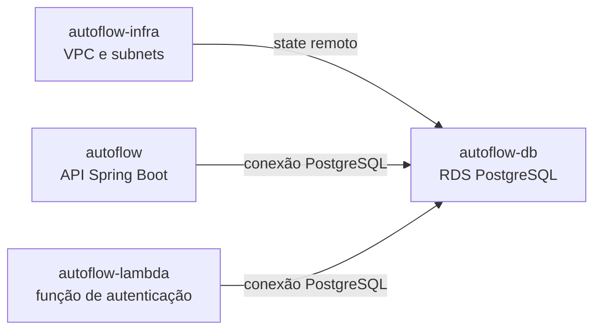

# AutoFlow — Infraestrutura do RDS

Este repositório contém a configuração Terraform final para provisionar o PostgreSQL gerenciado do AutoFlow na AWS. Após reset do Learner Lab, reexecute as pipelines CI/CD correspondentes para provisionar novamente os recursos.

## Responsabilidade e dependências

O root `infra/` declara uma instância Amazon RDS PostgreSQL 17, subnet group e Security Groups. Ele consome saídas do state Terraform da infraestrutura compartilhada, mantida em `autoflow-infra`. A aplicação Spring Boot e a Lambda usam o banco conforme suas configurações.



O diagrama representa dependências declaradas, não conectividade ou implantação confirmada.

## Esquema, migrations e seeds

O modelo relacional implementado é versionado pelo Flyway na aplicação `autoflow`, em
[`backend/src/main/resources/db/migration`](https://github.com/autoflow-fiap/autoflow/tree/develop/backend/src/main/resources/db/migration). As migrations
definem usuários, clientes, veículos, ordens de serviço, serviços, peças/insumos e entidades relacionadas; constraints
e evolução de schema devem ser lidas nas migrations. O backend executa Flyway conforme sua configuração. Este repositório
provisiona RDS e não mantém uma cópia independente do schema.

A migration V49 deste repositório está em [`migrations/V49__corrigir_documentos_seeds_demo.sql`](migrations/V49__corrigir_documentos_seeds_demo.sql).
Há também uma migration V49 da aplicação em [`V49__corrigir_documentos_seeds_demo.sql`](https://github.com/autoflow-fiap/autoflow/blob/develop/backend/src/main/resources/db/migration/V49__corrigir_documentos_seeds_demo.sql),
e a aplicação possui a V50 [`V50__corrigir_documentos_staff_demo.sql`](https://github.com/autoflow-fiap/autoflow/blob/develop/backend/src/main/resources/db/migration/V50__corrigir_documentos_staff_demo.sql),
que corrige documentos sintéticos de usuários demonstrativos não-clientes. São repositórios/localizações distintos;
`autoflow-db` não contém V50 em `migrations/`. Consulte
[detalhes dos seeds](docs/seeds-demonstracao.md).

## API e justificativa do banco

O contrato central está no [guia OpenAPI da aplicação](https://github.com/autoflow-fiap/autoflow/blob/develop/docs/openapi/README.md) e na [coleção Postman de autenticação CPF/JWT](https://github.com/autoflow-fiap/autoflow/blob/develop/backend/postman/autoflow-serverless-auth.postman_collection.json); este repositório não duplica os contratos. A justificativa técnica da escolha do PostgreSQL e da persistência relacional está em [RFC-001](docs/RFC-001.md).

## Configuração Terraform observada

| Propriedade | Valor declarado |
|---|---|
| Engine e versão | PostgreSQL 17 |
| Classe | `db.t3.micro` |
| Armazenamento inicial | 20 GB |
| Nome do banco | `autoflow_db` |
| Porta | 5432 |
| Subnets | IDs privados lidos do state de `autoflow-infra` |
| Acesso público | `publicly_accessible = false` |
| Criptografia do storage | `storage_encrypted = true` |
| Snapshot final | Obrigatório (`skip_final_snapshot = false`) |
| Proteção contra remoção | Ativada (`deletion_protection = true`) |
| Enhanced Monitoring | Desativado (`monitoring_interval = 0`) |

O nome do RDS, DB Subnet Group, snapshot final e Security Groups deriva de `project_name`. A homologação usa `autoflow`; produção usa `autoflow-production`. Isso separa os recursos também quando os dois ambientes usam a mesma conta AWS. Após reset do Learner Lab, reexecute as pipelines CI/CD para provisionar novamente os recursos e dependências do banco.

## Estado e pré-requisitos

O root declara backend S3 por meio de `infra/backend.tf` e consome o state da infraestrutura em `infra/rds-postgresql.tf`. Antes de qualquer inicialização ou plano remoto, confirme bucket, key, responsabilidade e state autoritativo com os responsáveis. Não inicialize um state vazio sobre recursos que possam existir.

O bucket e as keys do backend são parâmetros externos, não arquivos de exemplo versionados. Para uso local, configure `AWS_PROFILE`, `AWS_REGION`, `AWS_EXPECTED_ACCOUNT_ID`, `TF_VAR_aws_profile`, `TF_VAR_aws_allowed_account_ids` (JSON de uma lista), `TF_VAR_project_name`, `TF_VAR_terraform_state_bucket`, `TF_VAR_infra_state_key` e os inputs de banco por variáveis de ambiente locais ou por mecanismo seguro. Valide a identidade com `scripts/verify_aws_account.py` antes de acessar AWS. O `terraform init` recebe `-backend-config` para bucket, key, região, owner esperado, `encrypt=true` e `use_lockfile=true`.

O AWS Academy Learner Lab pode restringir políticas, boundaries, SCPs, contexto de `iam:PassRole`, quotas e duração da sessão. A saída `allowed`/`implicitDeny` de `simulate-principal-policy` é apenas uma simulação e **não garante autorização efetiva**. Inventários também se limitam à conta, região e permissões consultadas. Após reset do Learner Lab, reexecute as pipelines CI/CD dos repositórios na ordem de dependências para provisionar novamente o ambiente.

## Comandos Terraform

Os comandos abaixo são referências de fluxo. Execute-os somente com state, conta, perfil AWS e autorização previamente confirmados:

```bash
terraform init -backend=false -input=false
terraform fmt -check -recursive
terraform validate
```

Para usar backend remoto, somente após reconciliar state, passe os parâmetros aprovados em `terraform init -reconfigure -backend-config=...`. `plan`/`apply` não fazem parte da validação estática; `apply` altera recursos AWS e exige autorização explícita e revisão do plano. A configuração atual ativa proteção contra remoção e exige snapshot final; operações destrutivas continuam sujeitas a plano de recuperação aprovado.

## CI/CD

Consulte o [catálogo de variables e secrets](docs/variables-and-secrets.md) e o [histórico](docs/variables-changelog.md) para configurar GitHub Actions e inputs Terraform.

O workflow `.github/workflows/pipeline.yml` executa CI sem acesso AWS em Pull Requests e pushes de branches, incluindo branches de feature. `develop` seleciona o GitHub Environment `homolog` e `project_name=autoflow`; `main` seleciona `production` e `project_name=autoflow-production`. Push para `develop` executa Plan e, após os gates, Apply. Em `main`, Plan e Apply também exigem que o GitHub reporte a branch protegida (`github.ref_protected`). `workflow_dispatch` é limitado a `develop` e `main`; PRs e branches de feature nunca executam Plan ou Apply.

Plan e Apply são jobs vinculados ao Environment escolhido pela branch. Antes de configurar credenciais, o workflow consulta a API do GitHub para exigir que Variables e nomes de Secrets necessários estejam cadastrados explicitamente no Environment selecionado; valores definidos somente no nível do repositório ou organização não satisfazem esse gate. O workflow exige `AWS_EXPECTED_ACCOUNT_ID` com 12 dígitos e compara esse valor à identidade STS antes de consultar States ou inicializar o backend. Também valida que o owner do bucket corresponde à conta esperada.

As keys do root RDS e do State VPC/EKS consumido são fornecidas por Variables do GitHub Environment selecionado; o código não fixa sufixos nem escolhe State legado por default. As duas keys precisam começar pelo prefixo do Environment (`homolog/` ou `production/`), ser distintas e corresponder à key do root produtor VPC/EKS. `scripts/state_key_policy.py` falha fechado para Environment ou key ausente, prefixo incorreto, caminho inválido e keys iguais. As keys autoritativas e a presença dos objetos S3 não foram verificadas nesta alteração; nenhum State foi migrado ou inicializado.

O Apply valida que há Required reviewers efetivos, que a política de branch do Environment permite somente a branch correspondente e que `TERRAFORM_APPLY_APPROVAL_CONFIGURED` está configurada como `true` antes de usar credenciais AWS. Configure os Environments e restrinja `homolog` à branch `develop` e `production` à `main`; mantenha `TERRAFORM_APPLY_APPROVAL_CONFIGURED` diferente de `true` até os gates estarem presentes. O Plan gera um artifact criptografado com AES-256 via OpenPGP e retenção de um dia; o Apply verifica integridade, run, commit, Environment, conta esperada, bucket, keys, região e projeto antes de descriptografar e aplicar exatamente o plano revisado. A chave de criptografia é o Secret `TF_PLAN_ENCRYPTION_KEY` do Environment e não é versionada. O guard `scripts/review_rds_plan.py` continua bloqueando qualquer `delete` ou substituição de recurso.

Para homologação e produção, cadastre os mesmos nomes de Variables e Secrets em cada GitHub Environment, com valores próprios para cada ambiente. As Variables necessárias são `AWS_REGION`, `AWS_EXPECTED_ACCOUNT_ID`, `AWS_TERRAFORM_STATE_BUCKET`, `AWS_TF_STATE_KEY`, `AWS_INFRA_STATE_KEY` e `TERRAFORM_APPLY_APPROVAL_CONFIGURED`. Os Secrets necessários são `AWS_ACCESS_KEY_ID`, `AWS_SECRET_ACCESS_KEY`, `AWS_SESSION_TOKEN`, `DATABASE_USERNAME`, `DATABASE_PASSWORD` e `TF_PLAN_ENCRYPTION_KEY`. O workflow rejeita valores definidos somente no escopo do repositório ou organização. `AWS_REGION` deve corresponder à região do bucket e dos recursos do Environment. Nunca registre valores de Secrets no repositório.

O desenho não fixa Account ID nem ARN e pode ser usado em diferentes Learner Labs sem alterar o código: configure credenciais temporárias, conta esperada, bucket e states de cada Environment. A portabilidade do Terraform não garante permissões IAM ou cotas na conta de destino. A configuração real dos GitHub Environments, reviewers, buckets, States e permissões AWS não é comprovada por validações locais.

## Fontes

- [`infra/rds-postgresql.tf`](infra/rds-postgresql.tf)
- [`infra/sg.tf`](infra/sg.tf)
- [`infra/backend.tf`](infra/backend.tf)
- [Migrations e seeds demonstrativos](docs/seeds-demonstracao.md)
- [Modelo relacional implementado](https://github.com/autoflow-fiap/autoflow/tree/develop/backend/src/main/resources/db/migration)
- [RFC-001 — PostgreSQL e estratégia relacional](docs/RFC-001.md)
