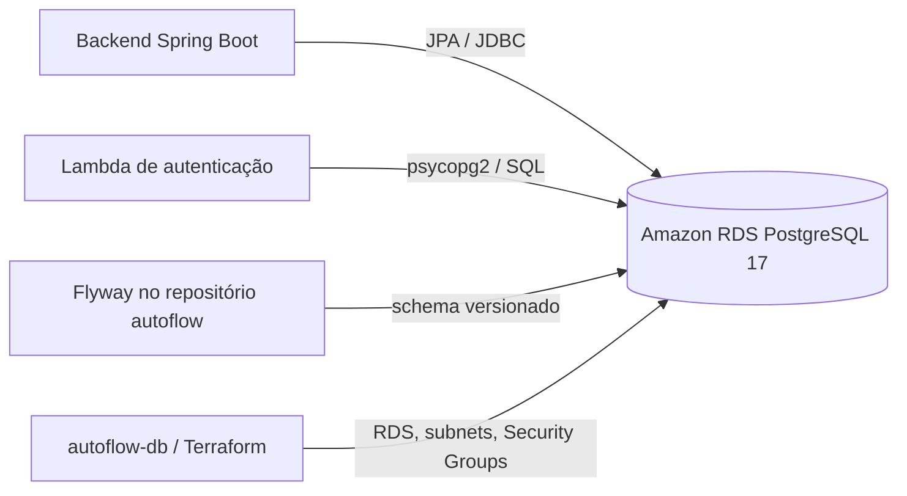

# RFC-001 — PostgreSQL e estratégia de persistência relacional

- **Status:** implementação refletida no código e na configuração versionados; o estado operacional da AWS não foi consultado.
- **Data:** 02/11/2026.
- **ADR relacionada:** [ADR-001 — PostgreSQL como mecanismo de persistência](adr/ADR-001-postgresql.md).
- **Escopo:** banco relacional do AutoFlow, provisionamento RDS em `autoflow-db` e propriedade do schema no backend `autoflow`.

## 1. Contexto e problema

### Síntese executiva

O backend Spring Boot usa PostgreSQL via JPA/Hibernate e mantém o histórico do schema em migrations Flyway. O root Terraform deste repositório declara Amazon RDS PostgreSQL 17 privado, classe `db.t3.micro`, 20 GB gp3, storage criptografado, retenção de backup de um dia, snapshot final obrigatório e proteção contra remoção. Esses valores são configuração versionada; não comprovam recursos ativos nem disponibilidade atual na AWS.

### Cenário observado

O modelo persistido abrange usuários, clientes, veículos, ordens de serviço, serviços solicitados, reparos adicionais, orçamentos, itens, histórico de status e notificações. As migrations criam relações, constraints, índices e transações necessários às operações do domínio. O backend administra o schema e as migrations; `autoflow-db` administra RDS, subnets e Security Groups. Não há uma segunda cópia autoritativa de schema neste repositório.

As migrations também contêm mecanismos específicos do PostgreSQL: V37 habilita `pg_trgm` e cria índices GIN para buscas textuais em número de OS e dados de cliente; V43 usa índice único parcial para limitar a relação opcional entre reparo adicional e orçamento. Nem todo campo identificador é FK: alguns IDs de catálogo e snapshots são escalares. A integridade efetiva, portanto, deve ser descrita migration a migration, e não generalizada a todas as colunas.

### Objetivos e não objetivos

**Objetivos:** manter persistência relacional compatível com o schema/mapeamento atuais; usar RDS para reduzir a responsabilidade de operar o processo do banco; preservar uma única fonte de migrations; limitar acesso por rede e revisar alterações de banco por State/Plan.

**Não objetivos:** redesenhar o domínio ou o schema; normalizar snapshots existentes; criar FKs/constraints que não estão nas migrations; migrar para outro mecanismo; declarar alta disponibilidade, recuperação testada, custo medido ou estado AWS ativo.

### Restrições

- PostgreSQL é o engine configurado no datasource do backend e no recurso `aws_db_instance`.
- Flyway executa migrations no backend; a infraestrutura RDS não deve criar um schema concorrente.
- O RDS é declarado privado e permite entrada PostgreSQL do Security Group do cluster EKS e do Security Group da Lambda.
- O Terraform declara `monitoring_interval = 0`, retenção de backup de um dia e não declara Multi-AZ.
- Credenciais e Terraform State são dados sensíveis; marcar uma variável `sensitive` não remove seu valor do State.
- Não foi encontrado benchmark de engine, estudo de custo ou registro dos decisores da escolha original. A análise de alternativas abaixo é retrospectiva, não uma ata de aprovação histórica.

## 2. Proposta e solução

### Arquitetura e ownership

`autoflow-db` mantém o recurso RDS e a conectividade necessária. O backend `autoflow` contém as migrations Flyway que criam/evoluem o schema e as entidades JPA. A Lambda de autenticação consome tabelas existentes, mas não é proprietária das migrations. Essa separação reduz o risco de duas fontes tentarem ordenar ou aplicar a mesma mudança de schema.

### Estratégia de mudança de schema

1. Alterar o schema por nova migration Flyway em `autoflow`; migrations já aplicadas são imutáveis.
2. Revisar compatibilidade entre migration, entidades/repositories JPA, consultas da Lambda, dados existentes e rollback/recuperação possíveis.
3. Testar migrations e comportamento com PostgreSQL, inclusive recursos específicos como `pg_trgm`, GIN e índices parciais; testes H2 ou inspeção de entidades, isoladamente, não comprovam equivalência do engine.
4. Provisionar ou alterar infraestrutura RDS somente por Terraform no root deste repositório, com State, Plan e gates do ambiente correspondentes.
5. Tratar alteração de engine, major version, classe, storage, retenção, rede ou parâmetros como mudança de infraestrutura separada e revisada; não misturar com uma alteração funcional sem plano de compatibilidade.

V49 e V50 no backend corrigem dados demonstrativos existentes e não criam tabelas ou relacionamentos. O arquivo V49 duplicado em `autoflow-db/migrations/`, quando presente, não substitui a migration executada pelo backend; a fonte executável do schema continua sendo `autoflow/backend/src/main/resources/db/migration/`.

## 3. Alternativas consideradas

Não há comparação formal ou benchmark registrado. A avaliação retrospectiva abaixo relaciona o modelo atual a mecanismos concretos e seus impactos prováveis, sem afirmar medição de custo ou desempenho.

| Alternativa | Mecanismo e benefício possível | Trade-off para o modelo atual | Razão para não ser a configuração observada |
|---|---|---|---|
| PostgreSQL gerenciado em RDS (adotada) | SQL relacional, FKs/constraints, transações; compatibilidade com Flyway, JPA, `pg_trgm`, GIN e índice único parcial já presentes. O serviço gerenciado reduz a responsabilidade de operar host e processo do banco. | Mantém dependência do engine e do serviço AWS; requer rede privada, operação de credenciais, revisão de migrations e custo conforme classe, storage, backup e uso. A configuração atual não declara Multi-AZ e usa backup de um dia. | É o engine configurado no backend, nas migrations e no Terraform. Essa compatibilidade é observável; não é evidência de benchmark de superioridade. |
| MySQL/Aurora MySQL | Engine relacional com SQL e transações; seria alternativa para um sistema relacional. | V37 usa `pg_trgm`/GIN em `lower(numero_os)`, `lower(cliente_nome)` e `lower(cliente_cpf_cnpj)` para buscas `LIKE '%termo%'`. `FULLTEXT` tem semântica de tokens diferente e não substitui diretamente a busca por fragmentos. V43 é um índice único parcial sobre `orcamento_id`; como a coluna é nullable, um índice único comum no MySQL pode preservar a regra de múltiplos `NULL`, mas o DDL e a semântica precisam ser convertidos e verificados. Também mudam funções, collation e dialecto das migrations/queries. Aurora MySQL acrescentaria modelo operacional e cobrança próprios. | A objeção concreta é a busca por fragmentos: manter a semântica de V37 requer redesenhar mecanismo/consulta e validar resultados e desempenho com dados. A unicidade de V43 não é tratada como bloqueio insuperável; é migrável após confirmar a nulabilidade e o comportamento de `NULL`. O checkout não contém implementação/testes MySQL nem evidência de benefício que compense a conversão e validação. |
| DynamoDB ou outro armazenamento NoSQL | Acesso por chave e modelo gerenciado podem servir a workloads centrados em padrões de consulta conhecidos. | O modelo atual usa relações entre entidades, constraints, consultas relacionais e transações; seria necessário remodelar agregados, índices secundários, consistência, consultas e fluxos de escrita. Não há workload ou comparação de capacidade documentados que demonstrem benefício. | Não corresponde ao schema, às consultas e à camada JPA/Flyway observados; não foi comparado formalmente. |
| PostgreSQL autogerenciado em EC2/container | Maior controle de versão, extensão, parâmetros e ciclo de vida do processo. | Transfere à equipe patching, backups, recuperação, monitoração, capacidade, failover e proteção do host; adiciona componentes operacionais à implantação atual. | O root declara RDS gerenciado. Não foi encontrada necessidade versionada de administrar o host nem estudo de custo que justificasse assumir essa operação. |
| Schema versionado junto ao Terraform de `autoflow-db` | Concentraria infraestrutura e banco no mesmo repositório. | Misturaria lifecycle de RDS com evolução funcional do schema e duplicaria ownership com as migrations usadas pelo backend; o pipeline da infraestrutura poderia aplicar alterações de aplicação em momentos inadequados. | O backend já executa Flyway e contém a fonte de migrations; a duplicação concorrente seria fonte de divergência. |

## 4. Impactos e riscos

**Compatibilidade:** a troca de engine não é transparente: recursos PostgreSQL específicos e comportamento de queries/migrations precisam ser preservados ou substituídos. Uma mudança de schema pode afetar backend e Lambda ao mesmo tempo, inclusive quando ambos compartilham tabelas.

**Segurança:** o RDS é privado e a regra de entrada PostgreSQL referencia os Security Groups do EKS e da Lambda. Storage encryption está declarada. O Terraform recebe usuário e senha como inputs, com senha marcada `sensitive`; isso mascara valores em algumas saídas, mas não impede que os valores necessários à gestão apareçam no State ou na configuração de runtime. A política efetiva de acesso ao State e a configuração atual da conta não foram consultadas nesta revisão.

**Disponibilidade e recuperação:** snapshot final obrigatório e proteção contra remoção estão declarados; a retenção de backup é de um dia. Não há configuração Multi-AZ, Enhanced Monitoring ou evidência de restauração testada nos artefatos inspecionados. Esses limites não permitem prometer RPO/RTO ou alta disponibilidade.

**Performance e custo:** GIN/`pg_trgm` e índices parciais são mecanismos declarados para consultas/relações específicas, não resultados de benchmark. Classe `db.t3.micro`, 20 GB e retenção indicada descrevem parâmetros, mas custo e capacidade real dependem da região, conta, tráfego e uso; não foram medidos.

| Risco | Mitigação/limite observado |
|---|---|
| Migration incompatível com o código ou com dados existentes | Revisar novas migrations, executar testes de integração com PostgreSQL/Flyway e validar consumers JPA e Lambda antes da promoção. Não editar migration já aplicada. |
| Supor integridade referencial que não existe para todo ID | Conferir a migration da coluna; o diagrama distingue FKs de IDs escalares e snapshots. Adicionar constraint exige mudança funcional própria e análise dos dados existentes. |
| Exposição de credenciais por State, Plan ou configuração de runtime | Controlar IAM, acesso, retenção e cifragem dos artefatos externos; não registrar valores. `sensitive` não é mecanismo de remoção do State. |
| Perda/corrupção do banco ou recuperação não testada | Preservar snapshot final e proteção contra remoção; definir e executar teste de restauração/RPO/RTO como trabalho operacional separado. A existência de backup configurado não prova restauração. |
| Sobrecarga/limite da instância | Observar conexões, CPU, memória, armazenamento e latência na conta antes de dimensionar; nenhum limite medido é declarado nesta RFC. |
| Drift entre roots/repositórios ou State incorreto | Validar Environment, ownership, keys remotas e outputs antes do Plan/Apply; seguir a ordem de dependências documentada nos runbooks. |

## 5. Plano de implantação e recuperação

Não há mudança de engine ou migração de dados proposta nesta RFC: o rollout documenta o processo de evolução compatível com a arquitetura vigente.

1. Validar o Environment, conta, região, key do State RDS e State VPC/EKS consumido.
2. Gerar e revisar Plan do root `autoflow-db`; não executar Apply sem aprovação/gates do fluxo configurado.
3. Para mudança de schema, revisar migration Flyway e compatibilidade de leitura/escrita; executar testes que inicializam PostgreSQL e aplicam migrations antes de promover a aplicação.
4. Aplicar migration com o fluxo de deploy do backend, que é o proprietário do schema. A infraestrutura de banco não executa uma cópia independente das migrations.
5. Depois de alteração autorizada, validar conectividade apenas por consumidores/SGs previstos, versão Flyway, integridade das operações e métricas disponíveis. Nenhuma consulta operacional AWS foi feita nesta revisão.

Em caso de reset do Learner Lab ou perda de recursos, identificar se RDS e bucket/State ainda existem antes de executar qualquer pipeline. Reconciliar State e recursos com os runbooks; não inicializar State vazio sobre recursos existentes nem assumir que reexecutar pipelines é seguro sem Plan. Recuperação por snapshot requer um procedimento autorizado e validação de consistência com a versão do schema/código.

## 6. Critérios de aceite e evidências

| ID | Critério | Verificação esperada | Evidência versionada |
|---|---|---|---|
| CA-01 | Engine e configuração de RDS correspondem à decisão | Inspecionar engine/version, classe, rede, storage, backup, snapshot e deletion protection | `infra/rds-postgresql.tf` |
| CA-02 | Acesso ao banco é limitado pelos grupos declarados | Inspecionar ingress TCP 5432 e origem dos SGs de EKS/Lambda | `infra/sg.tf`, outputs e States consumidos |
| CA-03 | Backend é proprietário das migrations | Confirmar datasource PostgreSQL/Flyway e migrations no backend; não há fonte concorrente aplicada por este root | `autoflow/backend/src/main/resources/db/migration/`, `autoflow-db/infra/` |
| CA-04 | Recursos específicos de PostgreSQL estão identificados | Conferir V37 (`pg_trgm`/GIN) e V43 (índice único parcial), além de FKs por migration | V37, V43 e [`diagrama-er.md`](diagrama-er.md) |
| CA-05 | Alterações de schema passam por testes com PostgreSQL/Flyway | Executar testes de integração configurados com PostgreSQL/Testcontainers e confirmar migração limpa | `autoflow/backend/src/test/java/com/autoflow/integration/` e build Maven |
| CA-06 | Backup/restore atende objetivos operacionais | Confirmar configuração AWS e executar restauração controlada, incluindo medição autorizada de RPO/RTO | Terraform declara backup de 1 dia e snapshot final |
| CA-07 | State e credenciais têm proteção efetiva | Revisar bucket, IAM, criptografia, logs, acesso ao State/Plan e rotação de credenciais | `infra/backend.tf`, workflow e configuração do ambiente |

Não são declarados benchmark de consultas, custo medido, RPO/RTO validado, Multi-AZ ou restore testado. As extensões e os índices comprovam apenas mecanismos definidos nas migrations.

## Referências

- [ADR-001 — PostgreSQL como mecanismo de persistência](adr/ADR-001-postgresql.md)
- [README e configuração declarada](../README.md)
- [`infra/rds-postgresql.tf`](../infra/rds-postgresql.tf), [`infra/sg.tf`](../infra/sg.tf) e [`infra/vars.tf`](../infra/vars.tf)
- [Migrations Flyway do backend](https://github.com/autoflow-fiap/autoflow/tree/develop/backend/src/main/resources/db/migration)
- [Migration V37 — `pg_trgm` e índices GIN](https://github.com/autoflow-fiap/autoflow/blob/develop/backend/src/main/resources/db/migration/V37__add_ordem_servico_listing_indexes.sql)
- [Migration V43 — proteção de relação de reparo/orçamento](https://github.com/autoflow-fiap/autoflow/blob/develop/backend/src/main/resources/db/migration/V43__protect_reparo_adicional_relationships.sql)
- [Diagrama ER e limites das FKs](diagrama-er.md)
- [Guia de CI/CD do banco](ci-cd-automatico.md)
