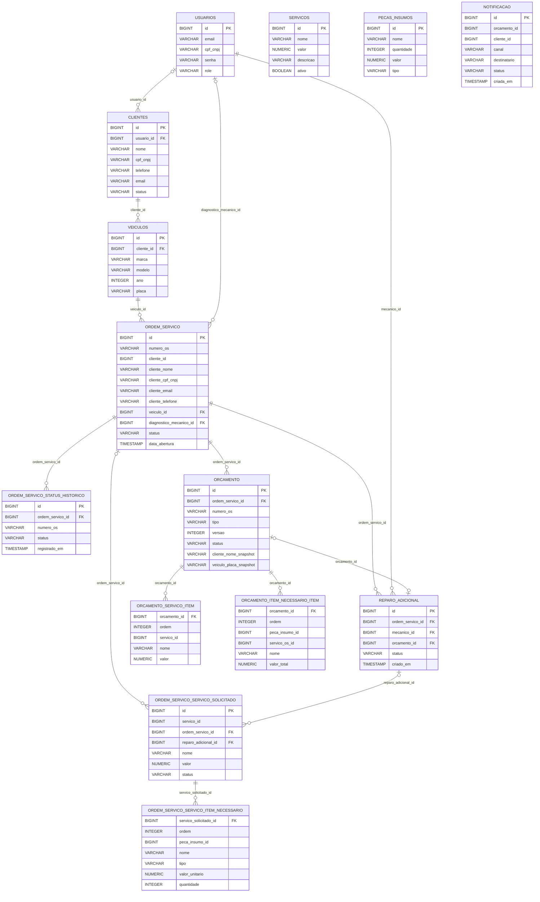

# Diagrama ER do AutoFlow

O diagrama representa as relações relacionais declaradas nas migrations Flyway do backend e o mapeamento JPA atual. Campos de identificador que não possuem chave estrangeira não são desenhados como relacionamentos.

## Relacionamentos e decisões de persistência

- `clientes.usuario_id` é uma FK opcional em V5, e a entidade Java usa `@OneToOne`. V5 não declara constraint `UNIQUE` para essa coluna; a cardinalidade permitida pela migration pode ser mais ampla que o mapeamento JPA.
- Cada veículo tem `cliente_id` obrigatório e FK para `clientes` em V1. A entidade Java usa `@ManyToOne`, mas não declara `nullable = false`; o diagrama segue a obrigatoriedade do schema Flyway.
- Cada ordem referencia obrigatoriamente um veículo e, opcionalmente, o mecânico do diagnóstico. V10 remove a FK de `ordem_servico.cliente_id` e adiciona os campos de cliente copiados como snapshot; portanto, esse `cliente_id` não é relação vigente com `clientes`.
- O histórico de status referencia a ordem por FK (V17). `HistoricoStatusOsEntity` representa o identificador como campo escalar, embora o schema mantenha a integridade referencial.
- Um serviço solicitado pode pertencer a uma ordem ou a um reparo adicional; os dois vínculos são opcionais no banco. Seus itens necessários são armazenados na tabela de coleção ligada ao serviço solicitado. `servico_id` e `peca_insumo_id` são identificadores sem FK para o catálogo.
- Reparo adicional referencia obrigatoriamente uma ordem e um mecânico. `orcamento_id` é opcional e tem índice único parcial (V43), limitando a associação a um orçamento por reparo e vice-versa.
- Orçamento referencia obrigatoriamente uma ordem. Os serviços e itens do orçamento ficam em tabelas de coleção ligadas ao orçamento; os dados de cliente e veículo são snapshots. Os campos `servico_id`, `peca_insumo_id` e `servico_os_id` nessas coleções não são FKs.
- `notificacao.orcamento_id` e `notificacao.cliente_id` não possuem FKs nas migrations; por isso o diagrama não representa essas colunas como relacionamentos.

As migrations V49 e V50 da aplicação alteram documentos de registros demonstrativos já existentes, sem modificar tabelas, colunas ou relacionamentos. A V49 também sincroniza um valor de documento armazenado no snapshot da ordem; a V50 atualiza documentos de usuários demonstrativos. A confirmação dessas migrations no RDS depende de consulta autorizada ao histórico Flyway após recriar a infraestrutura.
