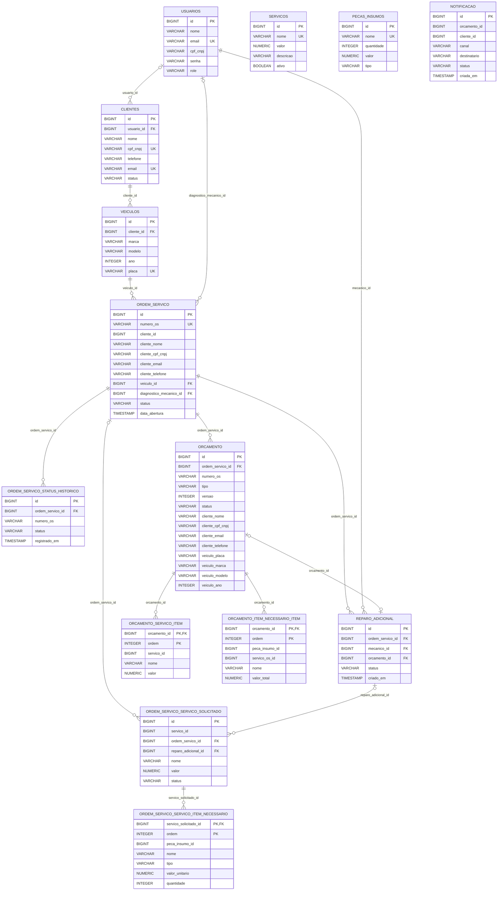

# Diagrama ER do AutoFlow

O diagrama usa nomes físicos das tabelas e colunas resultantes das migrations Flyway do backend. `PK`, `FK` e `UK` indicam chaves; a nulabilidade e os índices parciais são explicados abaixo.

## Relacionamentos, nulabilidade e cardinalidades do schema

| Colunas e relação | Obrigatoriedade e cardinalidade no schema | Fonte/observação |
|---|---|---|
| `clientes.usuario_id` → `usuarios.id` | FK opcional; um usuário pode ser referenciado por zero ou vários clientes, pois não há `UNIQUE` em `usuario_id`. | V5. |
| `veiculos.cliente_id` → `clientes.id` | FK obrigatória; cada veículo tem um cliente e um cliente pode ter vários veículos. | V1; a FK usa `ON DELETE CASCADE`. |
| `ordem_servico.veiculo_id` → `veiculos.id` | FK obrigatória; cada OS tem um veículo e um veículo pode aparecer em várias OS. | V2. |
| `ordem_servico.diagnostico_mecanico_id` → `usuarios.id` | FK opcional; uma OS pode não ter mecânico de diagnóstico e um usuário pode estar em várias OS. | V7; índice em `diagnostico_mecanico_id`. |
| `ordem_servico_status_historico.ordem_servico_id` → `ordem_servico.id` | FK obrigatória; cada registro pertence a uma OS e uma OS pode ter vários registros. | V17; `ON DELETE CASCADE`. |
| `ordem_servico_servico_solicitado.ordem_servico_id` → `ordem_servico.id` | FK opcional no schema final. | V2 cria a FK; V32 remove `NOT NULL`, sem remover a FK. |
| `ordem_servico_servico_solicitado.reparo_adicional_id` → `reparo_adicional.id` | FK opcional no schema final. | V26. Não há constraint exigindo que exatamente um dos vínculos com OS/reparo esteja preenchido. |
| `ordem_servico_servico_item_necessario.servico_solicitado_id` → serviço solicitado | FK obrigatória e parte da PK composta (`servico_solicitado_id`, `ordem`); um serviço solicitado tem zero ou vários itens. | V13/V30; `ON DELETE CASCADE`. |
| `reparo_adicional.ordem_servico_id` → `ordem_servico.id` | FK obrigatória; uma OS pode ter vários reparos adicionais. | V43. |
| `reparo_adicional.mecanico_id` → `usuarios.id` | FK obrigatória; um usuário pode constar em vários reparos. | V43. |
| `reparo_adicional.orcamento_id` → `orcamento.id` | FK opcional; índice único parcial em valores não nulos limita cada reparo a no máximo um orçamento e cada orçamento a no máximo um reparo. | V25/V43. |
| `orcamento.ordem_servico_id` → `ordem_servico.id` | FK obrigatória; uma OS pode ter vários orçamentos/versionamentos. | V11; `ON DELETE CASCADE`. |
| `orcamento_servico_item.orcamento_id` → `orcamento.id` | FK obrigatória e parte da PK composta (`orcamento_id`, `ordem`); um orçamento pode ter vários itens. | V11; `ON DELETE CASCADE`. |
| `orcamento_item_necessario_item.orcamento_id` → `orcamento.id` | FK obrigatória e parte da PK composta (`orcamento_id`, `ordem`); um orçamento pode ter vários itens. | V11; `ON DELETE CASCADE`. |

As cardinalidades desenhadas seguem as constraints Flyway. A notação ER não expressa nulabilidade por si só; as colunas de FK marcadas como opcionais acima aceitam `NULL` no schema final.

## Constraints e índices relevantes

- As constraints únicas individuais incluem `usuarios.email`, `clientes.cpf_cnpj`, `clientes.email`, `veiculos.placa`, `servicos.nome`, `pecas_insumos.nome` e `ordem_servico.numero_os`. `usuarios.cpf_cnpj` (V47) não recebe constraint `UNIQUE` nessa migration.
- Orçamentos têm `UNIQUE (ordem_servico_id, tipo, versao)` e índice único parcial `(ordem_servico_id, tipo) WHERE status = 'DISPONIVEL'` (V11, V34 e V43). V38 troca o valor de tipo legado `ADICIONAL` por `COMPLEMENTAR`.
- V43 cria índice único parcial em `reparo_adicional.orcamento_id WHERE orcamento_id IS NOT NULL`, que sustenta a cardinalidade opcional 0..1.
- V42 cria índice único parcial para `ordem_servico.acompanhamento_token_hash` não nulo e constraints de período/criação do token; o token bruto não é coluna persistida.
- V8, V9/V13, V11/V38 e V46 declaram `CHECK` para tipos/status de peças, itens, orçamentos e clientes.
- Índices operacionais incluem os índices de OS/veículo/mecânico/histórico/orçamento e itens (V2, V7, V11, V17), cópias de `numero_os` (V33), listagem/data/status e busca trigram `pg_trgm`/GIN (V37), além da ordenação parcial por prioridade operacional (V45). Eles não alteram as cardinalidades.

As migrations V49 e V50 alteram documentos de registros demonstrativos sem modificar tabelas, colunas ou relacionamentos. A V49 também sincroniza um documento armazenado no snapshot da OS; a V50 atualiza documentos de usuários demonstrativos. Após reset do Learner Lab, reexecute as pipelines CI/CD para provisionar os recursos e executar as migrations Flyway da aplicação.
